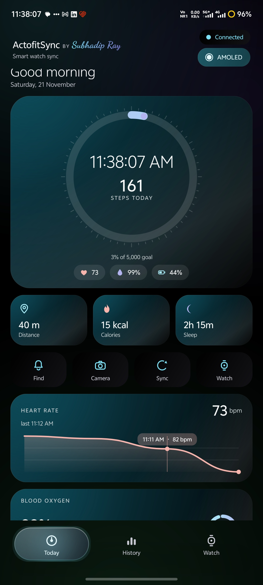
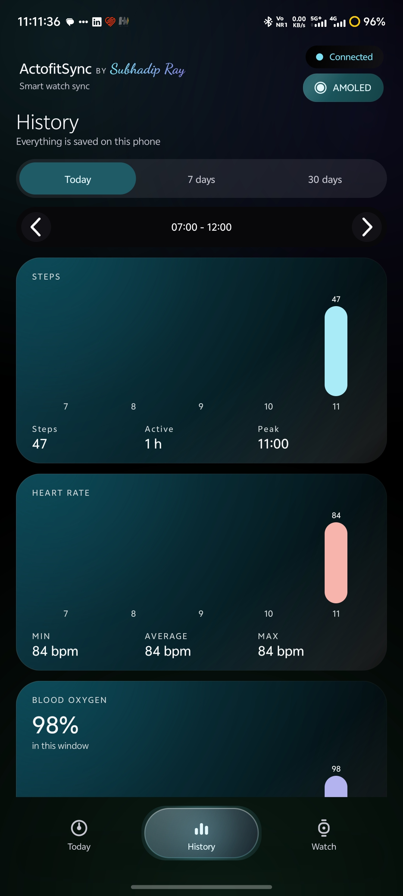
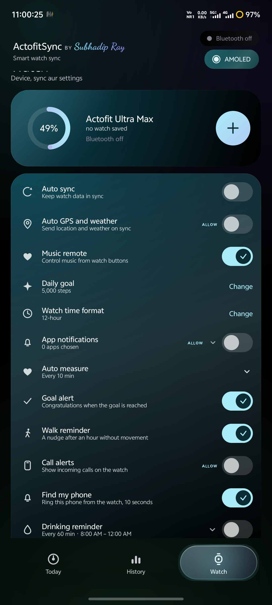
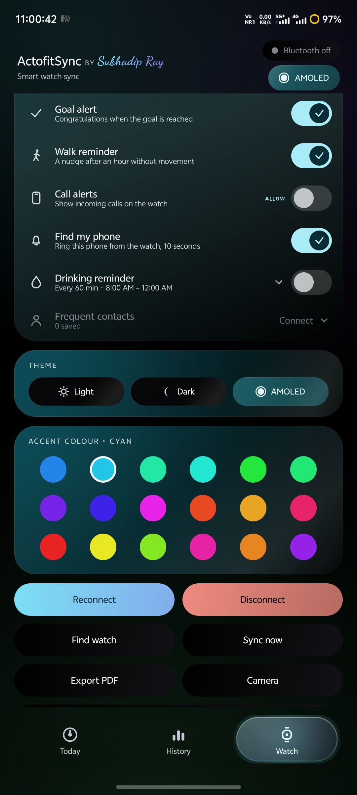

# Actofit Sync

**Unofficial companion app for Actofit Ultra Max**

 

The official Actofit app no longer works.  
It forces a login that always fails, and even after bypassing login there is no way to add the watch.

**Actofit Sync** was built from scratch so that Actofit Ultra Max users can finally connect their watch without any account or login or even offline.

---

### Features

| Category | Features |
| :--- | :--- |
| **Health & Tracking** | Heart Rate • SpO₂ • BP • Sleep • Steps • Calories • Daily Goal • 30-Day Charts • History Page |
| **Smart Controls** | Find Phone • Music Remote • Camera + Gallery • Call Alerts |
| **Smart Reminders** | Walk Reminder • Goal Alert • Drinking Reminder |
| **Sync & Automation** | Auto Sync • Auto GPS & Weather • Auto Measure • Watch Time Format |
| **Customization** | App Notifications (custom apps) • AMOLED Theme |
| **Extra** | Battery Status • PDF Export |

---

### Screenshots of the app

  <table>
    <tr>
      <td></td>
      <td></td>
      <td></td>
      <td></td>
       <td></td>
    </tr>
  </table>

---

### Download

**[Download Actofit Sync_1.0.0_initial_release.apk](https://github.com/raysubhadip94/ActofitSync/releases/latest)**

> After installing, allow **Bluetooth** and **Location** permissions.

---

### How to Use

1. Install the APK
2. Open the app and grant permissions
3. Keep your watch turned on and near the phone
4. The app will automatically scan and connect

The first connection may take a few seconds. Once connected, the app continues syncing in the background.

---

### Support

- **Telegram Channel** → [t.me/cracking_school_2](https://t.me/cracking_school_2)
- You can also **donate** directly from inside the app if you find it useful

---

### Disclaimer

This is an **unofficial** app and is **not affiliated** with Actofit in any way.  
Use at your own risk.

 

  Made with ❤️ in india 

for Actofit Ultra Max users

